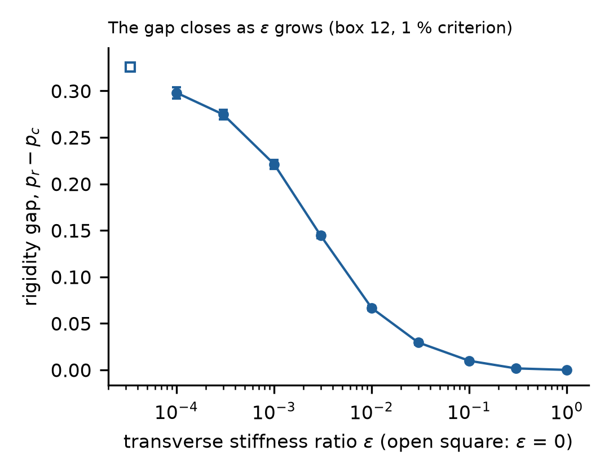
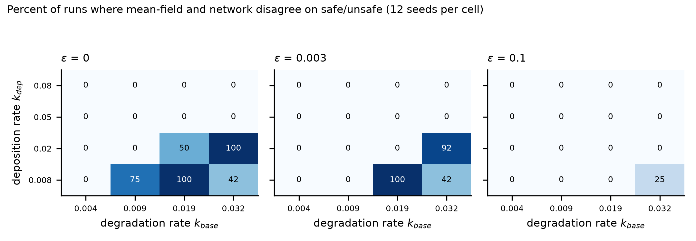
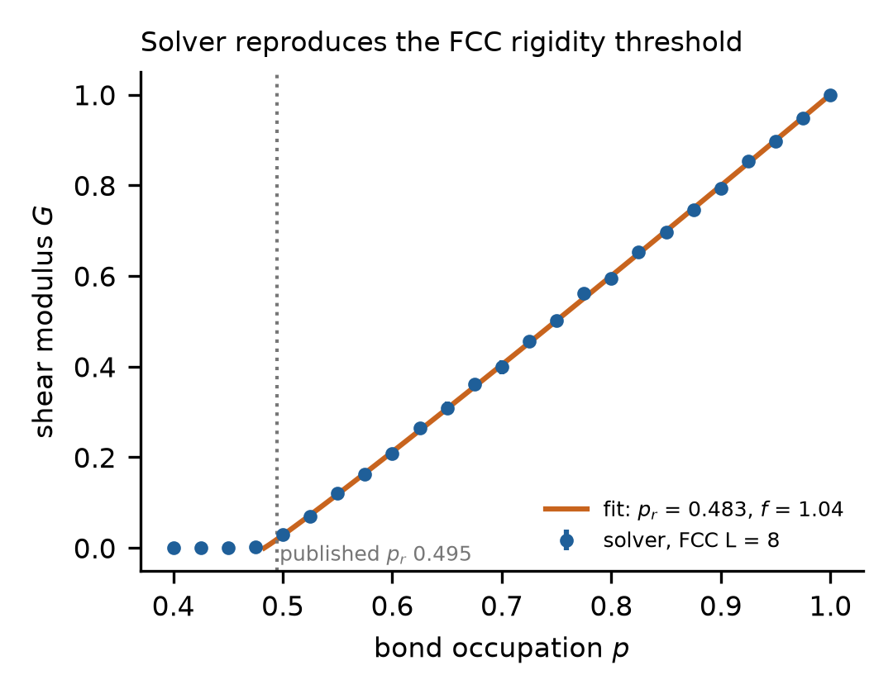

# gelrigidity

Rigidity percolation in an enzymatically degrading hydrogel scaffold that is replaced by newly deposited matrix. The shear modulus is computed from the bond network with a linear-response spring solver, so rigidity loss and connectivity loss are measured separately instead of being assumed to coincide.

## What the code does

- `gelrigidity.rigidity`: shear modulus of a periodic random geometric graph (or FCC lattice), with a transverse-to-longitudinal stiffness ratio `eps` (`eps = 0` is central-force, `eps = 1` is the random-resistor limit).
- `gelrigidity.dynamics`: scaffold bonds are cleaved and matrix bonds are deposited on one node set; scaffold, matrix and union moduli are recorded over time.
- `gelrigidity.handoff`: `Q = min_t G_union(t) / (f * G_union(0))`, with `Q >= 1` called safe, and the lag between loss of rigidity and loss of connectivity.
- `gelrigidity.mean_field`: the affine reverse-gelation law of Akalp, Bryant and Vernerey (Soft Matter 12, 7505, 2016), evaluated on the same occupancy trajectories, as the comparison model.

## Results stored in this repository

All numbers below are read from the CSV files in `results/`.

| Result | Value | File |
|---|---|---|
| Rigidity gap at `eps = 0` (1 % onset criterion, box 12, N = 1730) | 0.326, 95 % bootstrap interval 0.321 to 0.330 | `results/thermal/rigidity_gap_vs_eps.csv` |
| Gap at `eps = 0.1`, same settings | 0.010 | same |
| FCC bond connectivity threshold, solver vs published | 0.120 vs 0.12016 (Lorenz and Ziff 1998) | `results/fcc_crosscheck/validation_table.csv` |
| FCC rigidity threshold, solver vs published | 0.483 vs 0.495 (Chubynsky and Thorpe 2007) | same |
| Safe/unsafe calls where the mean-field law disagrees with the network model, `eps = 0` | 22.9 % (95 % bootstrap interval 17.2 to 28.6), all of them mean-field calling an unsafe run safe | `results/rgg_production/agreement_metrics.csv` |
| Same, `eps = 0.003` / `eps = 0.1` | 14.6 % (9.9 to 19.8) / 1.6 % (0 to 3.6) | same |

The agreement numbers come from one 4 x 4 grid of degradation and deposition rates, 12 seeds per cell, 576 runs, at N = 513 (box 8). The disagreement is confined to fast degradation with slow deposition (`results/rgg_production/mf_vs_network_cell_map.csv`). Rank order of Q is largely preserved (Spearman 0.91 to 0.93), so the two models differ mainly at the safe/unsafe boundary.





## Install and test

```
pip install -r requirements.txt
PYTHONPATH=. python -m pytest tests -q
```

The suite has 31 tests and ran in about 22 s on a laptop (31 passed).

## Reproducing the tables and figures

Regenerate the agreement tables and the figures from the stored simulation output:

```
PYTHONPATH=. python scripts/analyse_agreement.py
PYTHONPATH=. python scripts/make_figures.py
```

`analyse_agreement.py` reproduces the stored per-seed table and per-cell map to floating-point precision. The bootstrap intervals in `agreement_metrics.csv` are 95 % percentile intervals over runs, 2000 resamples, seed 1.

The simulations themselves are heavier and were not rerun when this package was assembled:

- `scripts/run_eps_sweep.py` produces `results/thermal/G_eps_box*.npz`.
- `scripts/analyse_phase_gap.py` turns those into the gap, window-dependent `p_r` and collapse tables.
- `scripts/run_full_comparison.py` produces `results/rgg_production/full_comparison_box8.npz`.
- `scripts/calibrate_time_units.py` and `scripts/audit_time_units.py` convert simulation steps to minutes using published MMP-cleavage kinetics (Schultz and Anseth 2013); this is an order-of-magnitude anchor only.

## Limitations

See `docs/LIMITATIONS.md`. In short: the critical exponent of the modulus is not determined (`p_r` is a range, 0.39 to 0.46); `eps` is phenomenological and not calibrated to a specific material; the decision comparison uses a single system size (N = 513); and the time calibration holds to an order of magnitude and uses a different gel chemistry.

## Licence and citation

MIT (`LICENSE`). Citation metadata is in `CITATION.cff`.
